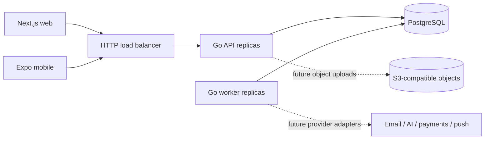

# Runtime architecture

The backend is one modular Go codebase with independently deployed API and worker processes. Adding instances does not require partitioning users between instances or keeping an instance alive for a session. This follows the [stateless process model](https://12factor.net/processes).

Solid arrows describe the foundation. Dotted arrows describe planned integrations. See `STATUS.md` for actual verification evidence and `PLANS.md` for the product roadmap.

## Boundaries

- `backend/` owns business rules, authorization, persistence and the canonical OpenAPI contract. The API handles short requests; durable work belongs in PostgreSQL and is consumed by workers.
- `web/` and `mobile/` consume `packages/api-client/`. The generated contract is shared; server authorization must never depend on either client enforcing a rule.
- `infra/` provides local orchestration. A production scheduler must supply equivalent routing, health probes, termination grace, secrets and shared services.
- Use domain-oriented internal packages as features arrive. Wire dependencies explicitly in `cmd/`; do not introduce separate network services just to divide source files.

## State ownership

| State                                                     | Owner                        | Foundation status                                                              |
| --------------------------------------------------------- | ---------------------------- | ------------------------------------------------------------------------------ |
| Durable jobs and internal probe results                   | PostgreSQL                   | Implemented for infrastructure verification                                    |
| Schema versions and migration coordination                | PostgreSQL                   | Explicit migration command                                                     |
| Sessions, magic-link tokens and roles                     | PostgreSQL                   | Planned in J1                                                                  |
| Course content, attempts and progress                     | PostgreSQL                   | Planned in J1/J3/J4                                                            |
| Consent, quotas, rate limits, payment event deduplication | Shared transactional storage | Planned with corresponding features                                            |
| Uploaded photos, audio and other objects                  | S3-compatible object storage | Local SeaweedFS infrastructure and initial bucket; application adapter planned |
| Build artifacts and disposable request buffers            | Process/container            | Never authoritative business state                                             |

No sticky sessions, instance-local session maps, local upload directories, in-memory job queues or per-instance counters for global quotas. Temporary request buffers are allowed if losing the process cannot lose an accepted user operation. Logs go to stdout; metrics and logs are not a substitute for durable audit records.

## Queue semantics

Workers atomically claim available jobs using PostgreSQL row locks and `SKIP LOCKED`, which PostgreSQL explicitly supports for [queue-like consumers](https://www.postgresql.org/docs/current/sql-select.html). Claims have a deadline; an abandoned claim becomes eligible for recovery. Ownership fencing prevents an old claimant from completing a job after a new claimant has taken it.

Delivery is **at least once**. A lease prevents concurrent claims during its validity; it cannot guarantee that an external service sees an operation only once. Handlers must use stable idempotency keys and commit related database changes atomically. The internal `system.probe` handler exercises this pattern without pretending to implement an email or AI provider.

When a future feature changes business state and enqueues work, write both in the same PostgreSQL transaction. External side effects need provider idempotency support or an explicit reconciliation strategy. Add bounded retries, an operator-visible failed state and a reprocessing procedure with each new handler. Never acknowledge a job before its durable effect succeeds.

## Scaling and failure boundaries

- Scale API replicas for request concurrency and worker replicas for queue latency independently. The local proxy must discover replica changes; replicas must not bind the same host port or require fixed container names.
- Local Docker DNS and proxy discovery converge asynchronously after a replica stops. The smoke test allows bounded recovery, then requires repeated successful requests; it does not establish a zero-downtime SLA. Production ingress must combine readiness checks and graceful draining.
- Every process has a bounded PostgreSQL pool. Plan `API replicas × API pool + worker replicas × worker pool + migrations + monitoring + administrative reserve <= available database connections`. Increasing replicas without a connection budget can reduce availability.
- PostgreSQL remains a shared capacity and availability boundary. Measure query latency, queue age, lock contention and connection use before increasing replicas; add pooling, indexes or database capacity when evidence warrants it.
- Object bytes belong outside PostgreSQL and application disks. Production object storage must enforce private access, lifecycle policies and the selected EU region.
- `/health/live` detects a responsive process. `/health/ready` checks whether its dependencies allow serving traffic. A dependency outage must not create an endless liveness restart loop.
- On termination, stop accepting new work, allow bounded request draining, cancel downstream I/O and close connections. Unfinished jobs remain recoverable after their lease expires.

## Deployment contract

Run versioned migrations once as a release step before starting the matching application version. Concurrent migration invocations coordinate through a PostgreSQL advisory lock; API startup never mutates the schema. Use additive, backward-compatible schema changes for rolling deployments, and remove old columns only after all callers have migrated.

The foundation does not claim production high availability or measured throughput. Before launch, configure database backups and restore drills, TLS, shared abuse controls, object validation, secrets, monitoring and EU hosting. Product features must preserve these boundaries when introduced.
