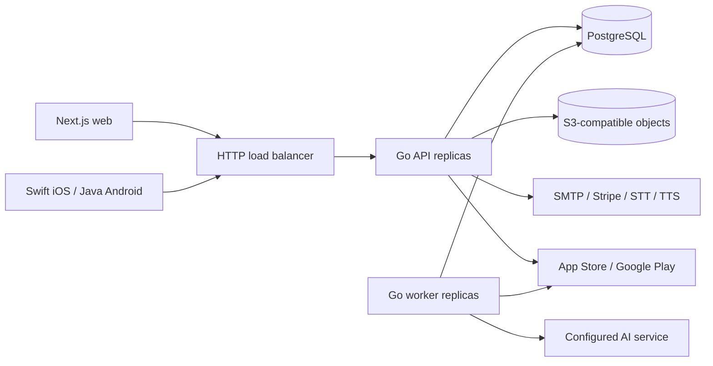

# Runtime architecture

The backend is one modular Go codebase with independently deployed API and worker processes. Adding instances does not require partitioning users between instances or keeping an instance alive for a session. This follows the [stateless process model](https://12factor.net/processes).

The diagram describes implemented integration boundaries; external services still need deployment credentials and live acceptance tests. See `STATUS.md` for actual verification evidence and `PLANS.md` for the product roadmap.

## Boundaries

- `backend/` owns business rules, authorization, persistence and the canonical OpenAPI contract. The API handles short requests; durable work belongs in PostgreSQL and is consumed by workers.
- `web/` consumes `packages/api-client/`; native clients use routes and Swift models generated by `mobile/generate.rb` from the same OpenAPI schema. The contract is shared; server authorization must never depend on either client enforcing a rule.
- `infra/` provides local orchestration. A production scheduler must supply equivalent routing, health probes, termination grace, secrets and shared services.
- Use domain-oriented internal packages as features arrive. Wire dependencies explicitly in `cmd/`; do not introduce separate network services just to divide source files.

## State ownership

| State                                                                   | Owner                                                                    |
| ----------------------------------------------------------------------- | ------------------------------------------------------------------------ |
| Durable queue, leases, retries and handler results                      | PostgreSQL                                                               |
| Hashed login tokens, sessions, roles, consent and rate limits           | PostgreSQL                                                               |
| Teacher content, attempts, progress, mock/oral sessions                 | PostgreSQL                                                               |
| Correction quota/usage, payment events and member rights                | PostgreSQL                                                               |
| Purchase reservations, encrypted store references, acknowledgement jobs | PostgreSQL                                                               |
| Private copies and subject PDFs                                         | S3-compatible storage                                                    |
| Video playback                                                          | Teacher-provided HTTPS URL; video streaming service chosen at release    |
| Unsynchronized mobile answers and photos                                | Account-scoped device SQLite; server authoritative after acknowledgement |
| Build artifacts and request buffers                                     | Disposable process/container                                             |

No sticky sessions, instance-local session maps, local upload directories, in-memory job queues or per-instance counters for global quotas. Temporary request buffers are allowed if losing the process cannot lose an accepted user operation. Logs go to stdout; metrics and logs are not a substitute for durable audit records.

## Queue semantics

Workers atomically claim available jobs using PostgreSQL row locks and `SKIP LOCKED`, which PostgreSQL explicitly supports for [queue-like consumers](https://www.postgresql.org/docs/current/sql-select.html). Claims have a deadline; an abandoned claim becomes eligible for recovery. Ownership fencing prevents an old claimant from completing a job after a new claimant has taken it.

Delivery is **at least once**. A lease prevents concurrent claims during its validity; it cannot guarantee that an external service sees an operation only once. Handlers must use stable idempotency keys and commit related database changes atomically. Handlers are `correct_submission`, `review_oral`, `delete_object`, `ack_store_purchase` and the infrastructure-only `system.probe`. Effects commit before transport acknowledgement. A replay detects persisted results or performs an idempotent deletion.

`worker.Consumer` and `worker.Delivery` isolate reception, acknowledgement and retry from business handlers. PostgreSQL remains the current transport. A future RabbitMQ adapter can implement these interfaces; database-to-broker publication must use a transactional outbox before replacing direct SQL enqueueing. No RabbitMQ deployment is currently implied.

Each worker processes one delivery at a time. Additional workers provide parallel execution; excess accepted work stays in the durable queue. The correction limit is separately enforced per student and UTC day, to bound paid inference use. It never limits the number of workers. On quota exhaustion the copy goes to teacher review. Submission request rate limits also defend upload resources.

A job has a 90-second lease, a 45-second handler budget and bounded retries. Shutdown stops reception and drains an active handler; the 60-second container grace covers execution plus retry recording. External AI calls have a 35-second deadline. Keep these values ordered if changing provider limits.

The clients read progress from persisted submission/job state: queued, processing, retrying, teacher review, completed or failed. They never invent a completion percentage. Polling is scoped to visible foreground screens and resumes from durable state.

When a feature changes business state and enqueues work, write both in the same PostgreSQL transaction. External side effects need provider idempotency support or an explicit reconciliation strategy. Add bounded retries, an operator-visible failed state and a reprocessing procedure with each new handler. Never acknowledge a job before its durable effect succeeds.

## Membership across payment providers

Stripe and verified native purchases feed the same `member_rights` view. The
server chooses tiers from configured products; clients receive capabilities and
the provider that manages their subscription. Apple and Google notifications
trigger a fresh provider read, serialized with restoration requests in PostgreSQL.
The database timestamps observations so clocks on separate API instances cannot
reverse a refund. Purchase ownership cannot move to another member after deletion.

Google acknowledgement runs from a durable job after access has been committed.
It rechecks the provider and retries reconciliation if the plan or state changed.
Short-lived purchase reservations coordinate the web and native payment sheets;
their identifiers prevent a late cancellation from releasing a newer reservation.
They cannot cancel payments already approved outside the application or a later
store approval. Existing overlapping provider subscriptions remain visible for
management rather than silently dropping a paid entitlement.

API and workers share the store reference encryption key and the deployment's
payment environment. Test and production subscriptions require separate databases;
the startup guard rejects an environment change on an established ledger. Optional
OAuth/JWKS caches are reconstructible provider credentials, not member state.

## Scaling and failure boundaries

- Scale API replicas for request concurrency and worker replicas for queue latency independently. The local proxy must discover replica changes; replicas must not bind the same host port or require fixed container names.
- Local Docker DNS and proxy discovery converge asynchronously after a replica stops. The smoke test allows bounded recovery, then requires repeated successful requests; it does not establish a zero-downtime SLA. Production ingress must combine readiness checks and graceful draining.
- Every process has a bounded PostgreSQL pool. Plan `API replicas × API pool + worker replicas × worker pool + migrations + monitoring + administrative reserve <= available database connections`. Increasing replicas without a connection budget can reduce availability.
- PostgreSQL remains a shared capacity and availability boundary. Measure query latency, queue age, lock contention and connection use before increasing replicas; add pooling, indexes or database capacity when evidence warrants it.
- Object bytes belong outside PostgreSQL and application disks. Production object storage must enforce private access, lifecycle policies and the selected EU region.
- `/health/live` detects a responsive process. `/health/ready` checks whether its dependencies allow serving traffic. A dependency outage must not create an endless liveness restart loop.
- On termination, stop accepting new work, allow bounded request draining, cancel downstream I/O and close connections. Unfinished jobs remain recoverable after their lease expires.

## Deployment contract

Run versioned migrations once as a release step before starting the matching application version. Concurrent migration invocations coordinate through a PostgreSQL advisory lock; API startup never mutates the schema. Use additive, backward-compatible schema changes for rolling deployments, and remove old columns only after all callers have migrated.

Local acceptance does not establish production high availability or measured throughput. Before launch, configure database backups and restore drills, TLS, shared abuse controls, object validation, secrets, monitoring and EU hosting. Product features must preserve these boundaries when introduced.
